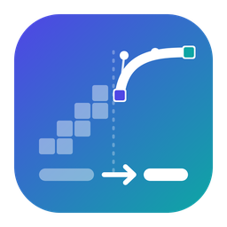
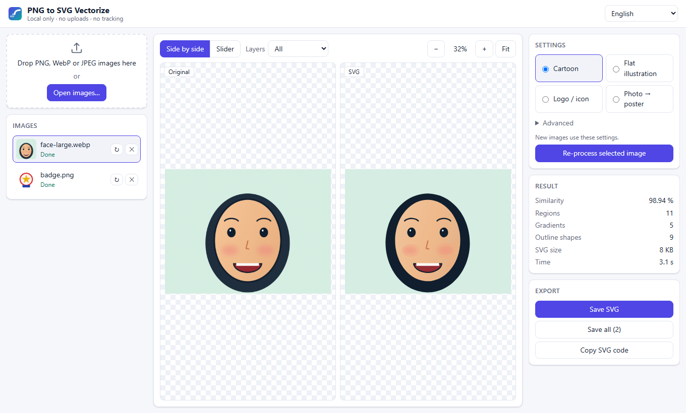

# PNG to SVG Vectorize

<p align="center"></p>

[](https://github.com/RidhuanDEV/png-to-svg-vectorize/actions/workflows/ci.yml)

Turn **raster cartoon illustrations** (PNG/WebP/JPEG — e.g. from image generators or scans) into **editable, library-free SVG**:

- **Gradient fills** — soft shading becomes one region with a fitted `linearGradient`, and round shading (balls,
  blush, glows) one elliptical `radialGradient` — not posterized bands or blotches.
- **Crisp outlines** — ink lines are separated by color unmixing into a sub-pixel accurate, smooth outline layer.
- **Pure SVG** — only `<path>`, `<rect>`, `<g>`, `<linearGradient>`, `<radialGradient>`. No `<image>`, CSS or scripts. Works in browsers,
  Figma/Illustrator/Inkscape, Flutter (`flutter_svg`), Android/iOS vector pipelines.
- **Safe to inline** — gradient ids are prefixed per file, so many SVGs can share one page.
- **Compact** — relative path commands with minimal number syntax (~50% smaller than absolute coordinates).

```text
input.png ──► outline separation ──► fill layer (regions + gradients) ──► SVG
               (ink alpha map)        (segmentation, union-find merge)    <defs> gradients
                                                                          <g id="fill">
                                                                          <g id="outline">
```

> **Status:** v1.0 — desktop app for **Windows and macOS**, local web UI, command line and Python library.
> **[Download](https://github.com/RidhuanDEV/png-to-svg-vectorize/releases)** ·
> [User guide](docs/user-guide.en.md) · [Panduan (ID)](docs/user-guide.id.md) · [Changelog](CHANGELOG.md)



## Install

```bash
git clone https://github.com/RidhuanDEV/png-to-svg-vectorize.git
cd png-to-svg-vectorize
pip install -e .            # add [dev] for tests
```

Requirements: Python ≥ 3.10, numpy, scipy, Pillow. No native tracer: curve fitting is built in.

## Usage

```bash
png2svg hero.png                         # -> hero.svg
png2svg scenes/*.png -o out/ --report    # batch + similarity check (needs Chrome or Edge)
png2svg logo.png --preset logo           # flat colors, crisp geometry (also: flat, poster, cartoon)
png2svg scenes/*.png -o out/ -j 8        # 8 worker processes (default: min(4, CPUs))
```

| Preset | For |
|---|---|
| `cartoon` (default) | character art with ink outlines and soft shading |
| `flat` | flat illustration: solid shapes, only clear gradients |
| `logo` | logos and icons: few flat colors, exact shapes, no gradients |
| `poster` | photos/paintings → poster look: fewer, larger regions |

```python
from PIL import Image
from pngsvg import Options, options_for, vectorize

result = vectorize(Image.open('hero.png'), Options(id_prefix='hero'))
# or a preset: options_for('logo', id_prefix='hero'); parallel fitting: vectorize(img, opts, executor=pool)
open('hero.svg', 'w', encoding='utf-8').write(result.svg)
print(result.regions, result.gradients, result.outline_paths)
```

### Options

| Option | Default | Meaning |
|---|---|---|
| `scale` | auto (long side ≈ 4500 px) | outline upscale for sub-pixel tracing |
| `tolerance` | `0.5` | max curve deviation of fill boundaries (px); higher = smaller file |
| `smooth` | `1.5` | fill boundary smoothing (px) |
| `hidden_tolerance` | `3` | looser tolerance where a fill boundary is hidden under the outline layer |
| `outline_tolerance` | `0.35` | max curve deviation of outlines (px) |
| `outlines` | `True` | separate ink outlines into their own layer |
| `gradients` | `True` | gradient fills (`False` = flat colors) |
| `radial` | `True` | allow elliptical radial gradients |
| `subpixel` | `True` | place fill boundaries at their sub-pixel edge position (from anti-aliasing) |
| `regions.merge_de` | `9` | neighbours closer than this ΔE may merge (soft shading). Lower keeps more detail |
| `regions.fit_de` | `3.5` | ...only if one linear gradient still explains the union (extra error per px, ΔE) |
| `regions.gradient_min_area` | `300` | smaller regions are always solid fills |
| `outline.core_de` | `9` | ΔE to the ink color for pure outline pixels |
| `outline.thin_depth` | `25` | thin anti-aliased lines: how much darker (L\*) than surroundings |
| `outline.halo_*` | — | flattening of light rims left by over-sharpened generators |

## How it works

1. **Ink detection.** The ink color is the median of the darkest pixels. Pure ink = close to it (ΔE), very dark,
   or a *thin* dark line (black top-hat) of ink-like hue — so 1–2 px lines that never reach full ink still count,
   while large dark areas (hair) and brown/grey strokes stay colors.
2. **Unmixing.** Around ink, each pixel is modelled as `alpha·ink + (1−alpha)·behind`. Pixels on that segment are
   anti-aliasing (alpha = position); pixels off it are real colors (lips, blush). The continuous alpha map is
   upsampled and thresholded → smooth outline with sub-pixel accuracy. Light same-hue rims next to ink
   (sharpening halos) are flattened.
3. **Regions.** The image without ink is edge-preserving smoothed (guided filter), palette-reduced and split into
   connected regions, then merged with a union-find: similar neighbours **only if one linear gradient still
   explains their union** (evaluated in O(1) from per-region sufficient statistics), tiny regions, and thin rims
   hugging outlines. So skin shading merges, while rings, blush and patterns stay separate.
4. **Gradients.** Per region: a linear model (direction of strongest change) and, for blob shading, an
   elliptical cone (center and ellipse refined by non-linear least squares). Stop colors at 0/.5/1 are solved by
   least squares against exactly what a renderer draws. Radial is used when it is clearly better; gradients that
   barely beat a solid color become solid. Concentric bands of a ball or glow are first grown back into one
   region.
5. **Sub-pixel edges.** Boundary pixels shifted by the segmentation filters are moved back to the label their
   own color belongs to, and each boundary crack is placed where the anti-aliasing says the edge is
   (`e = a_left + a_right − 1`), so straight edges stay straight and tips stay sharp.
6. **Shared boundaries.** The region label image becomes a planar map: every boundary between two regions is a
   chain between junctions, smoothed and fitted **once** and used by both regions, so neighbours never gap or
   overlap. Each region is painted as its outer boundary (holes are covered by the regions inside), largest
   first; a thin same-color stroke hides anti-aliasing seams.
7. **Curve fitting.** Chains are fitted with least-squares cubic Beziers (Schneider's algorithm) within a pixel
   tolerance, splitting at sharp corners. Boundaries hidden under the ink get a much looser tolerance. The
   outline is traced the same way from its sub-pixel mask. Paths use relative commands and minimal numbers.

## Web UI (local)

```bash
pip install -e ".[app]"
cd app/ui && npm ci && npm run build && cd ../..   # builds the UI into src/pngsvg_app/static
png2svg serve                                     # opens http://127.0.0.1:<port>/#t=<session token>
```

Drag images in (or **Open images…**), watch progress, compare original and SVG side by side or with a slider
(synchronized zoom up to 800 %, fills-only / outlines-only views), see a similarity score, change the preset or
advanced settings and re-process, then save one SVG, all SVGs (zip) or copy the SVG code. English and Bahasa
Indonesia; light/dark follows the system.

Privacy and safety: the service listens on `127.0.0.1` only, every API call needs the random per-session token
from the link, foreign `Host` headers are refused, uploads are limited to 50 MB / 8000 px and checked by content
(PNG, WebP, JPEG). Images and results stay in memory and are gone when the server stops.

UI development: `python -m pngsvg_app --port 8765 --token dev --no-browser`, then `npm run dev` in `app/ui` and
open `http://localhost:5173/#t=dev`.

## Desktop app

Installers are produced by the `Release` workflow: `PNG-to-SVG-Vectorize-Setup-x.y.z.exe` (Windows 10/11 x64,
per-user, no admin rights) plus a portable zip, and `PNG-to-SVG-Vectorize-x.y.z-arm64.dmg` / `-x64.dmg` (macOS 12+).
The builds are **not code-signed** (free, open source): Windows SmartScreen shows "Windows protected your PC" → *More
info* → *Run anyway*; on macOS open the app once with right-click → *Open* (or System Settings → Privacy & Security →
*Open Anyway*).

The app is the same UI in a native window (WebView2 / WKWebView) with native open/save dialogs. Everything runs on
the computer; the local service only listens on `127.0.0.1` with a per-session token.

From source: `pip install -e ".[desktop]"`, build the UI (see above), then `pngsvg-app`. Build the bundle with
`pip install -r packaging/requirements-build.txt && pyinstaller --noconfirm packaging/pngsvg.spec`;
`"dist/PNG to SVG Vectorize/PNG to SVG Vectorize.exe" --smoke` checks it (vectorizes one image, exit code 0).

## Quality check

`--report` renders the SVG with headless Chrome/Edge and prints similarity (100 − mean abs error %, and % of
pixels within 24/255). Typical cartoon illustrations reach 98–99 %. Always also compare visually at 2× zoom —
a single number can hide local defects.

## Limitations

- Designed for **cartoon / flat illustration** styles with ink outlines. Photos and painterly art produce many
  regions and large files.
- Linear and elliptical radial gradients only (no mesh gradients): glossy, strongly non-linear shading may show
  a few soft bands. Very faint tiny color spots may merge into their surroundings.
- One ink color per image; hairlines thinner than ~1.5 px that are mostly anti-aliasing can be lost.
- Transparent images are flattened onto white (the SVG has a background).
- File size grows with detail (≈ 100–400 KB for a 1536×1024 detailed scene).

## Tests

```bash
pip install -e ".[dev,app]"
pytest -q                                   # engine + API tests
cd app/ui && npm run check && npm run e2e   # UI type check + Playwright end-to-end tests (needs a UI build)
```

## Roadmap

See [docs/PLAN.md](docs/PLAN.md). Done: own curve fitting and shared boundaries (v0.2), radial
gradients, parallel processing and presets (v0.3) — see [docs/bench.md](docs/bench.md) — and a local web UI
(v0.4), desktop app + installers (v0.5), user guide and license-free comparison set (v1.0).

## License

[MIT](LICENSE) © Ridhuan Rangga Kusuma.

---

## Ringkasan (Bahasa Indonesia)

Alat untuk mengubah **ilustrasi kartun raster** (PNG/WebP/JPEG) menjadi **SVG path murni** yang bisa diedit:
isian bergradasi (kulit mulus, tanpa bercak), garis luar tajam dan akurat sampai sub-piksel, tanpa library/CSS/raster,
ID gradien unik per file, dan ukuran ringkas. Pemakaian: `png2svg gambar.png` (hasil `gambar.svg`),
atau `png2svg folder/*.png -o hasil/ --report` untuk banyak berkas sekaligus beserta ukuran kemiripan.
Selalu periksa juga secara visual pada perbesaran 2×. Antarmuka lokal: `pip install -e ".[app]"`, build UI di
`app/ui` (`npm ci && npm run build`), lalu `png2svg serve` — seret gambar, bandingkan, simpan SVG; semua tetap di
komputer Anda.
