# PNG to SVG Vectorize

<p align="center">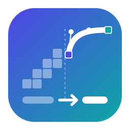</p>

<h3 align="center">Cartoons, logos, icons and pixel art → clean, editable SVG. Offline, in seconds.</h3>

<p align="center"><b>Measured in the open:</b> every number below comes from license-free pictures you can download
and re-run, with the pictures to prove it.</p>

<p align="center">
<a href="https://github.com/RidhuanDEV/png-to-svg-vectorize/actions/workflows/ci.yml"></a>
<a href="https://github.com/RidhuanDEV/png-to-svg-vectorize/releases/latest"></a>


<a href="LICENSE"></a>
</p>

<p align="center">
<a href="https://ridhuandev.github.io/png-to-svg-vectorize/"><b>Website</b></a> ·
<a href="https://github.com/RidhuanDEV/png-to-svg-vectorize/releases/latest"><b>Download</b></a> ·
<a href="docs/user-guide.en.md">User guide</a> ·
<a href="docs/user-guide.id.md">Panduan (ID)</a> ·
<a href="docs/research.md">Technical report</a> ·
<a href="CHANGELOG.md">Changelog</a>
</p>

<p align="center">
<a href="#before-and-after">Before and after</a> ·
<a href="#benchmark">Benchmark</a> ·
<a href="#against-other-tracers">vs. other tracers</a> ·
<a href="#install">Install</a> ·
<a href="#usage">Usage</a> ·
<a href="#how-it-works">How it works</a> ·
<a href="#faq">FAQ</a> ·
<a href="#license">License</a>
</p>

---

## Before and after

The same pictures through the last release (1.6.0) and the current code. A checkerboard means *transparent*: a
hole in the SVG that a white page would hide. Under each result: similarity, visible-defect area and file size.

<p align="center">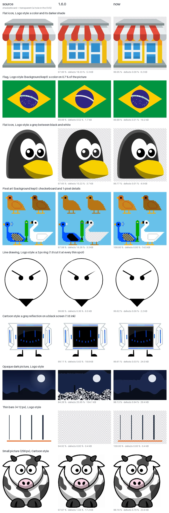</p>

Look at the first row: **1.6.0 scored 97.99 % on that shop icon while 18 % of it was visibly wrong** (red and dark
red, blue and dark blue merged). A high average hides a defect that covers a few percent of the picture. That is
why this project now reports the **visible-defect area** next to every score, and shows the pictures.

<details>
<summary><b>More evidence: source, SVG and where they differ, with the worst area enlarged</b></summary>

<p>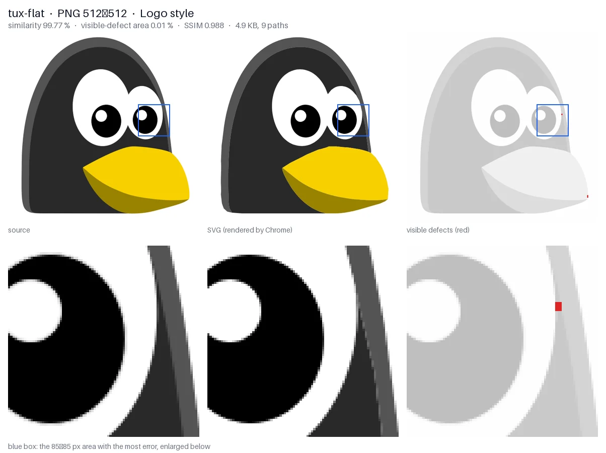</p>
<p>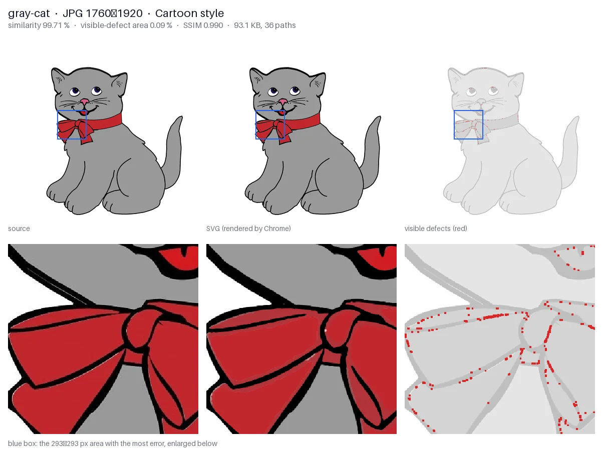</p>
<p>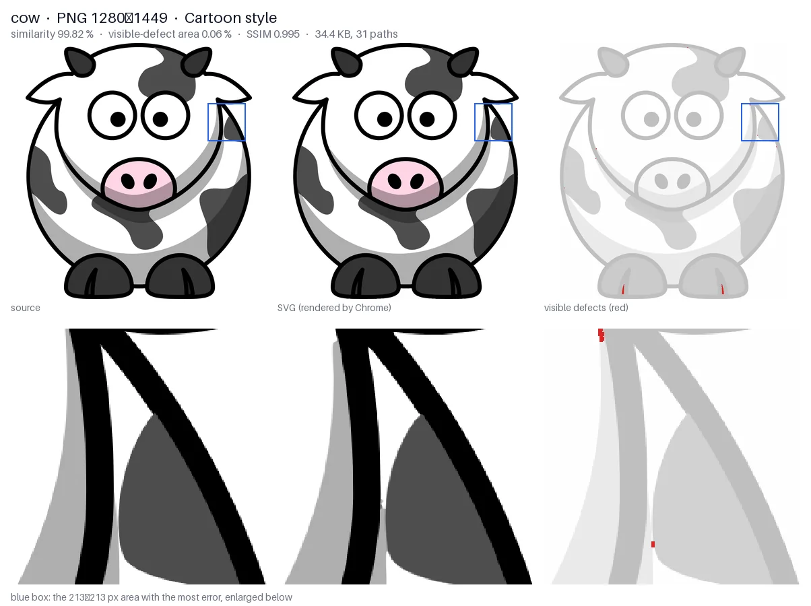</p>
<p>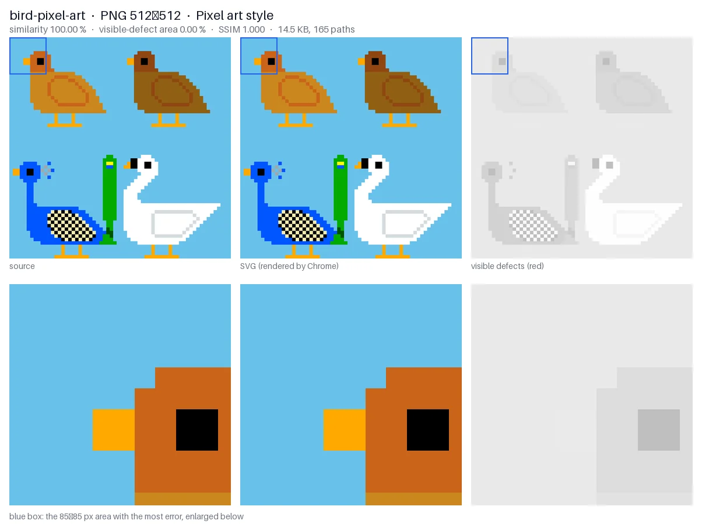</p>
<p>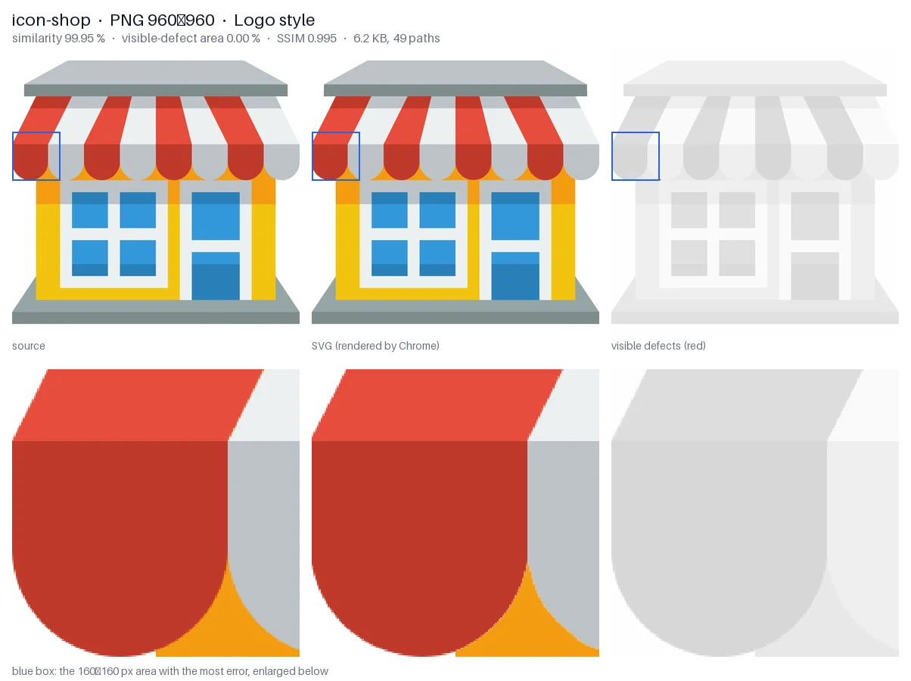</p>
<p>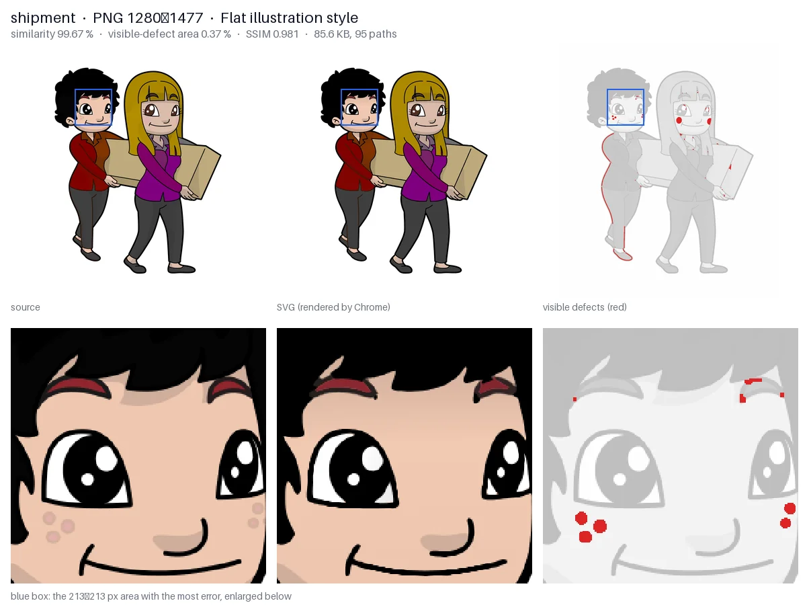</p>
<p>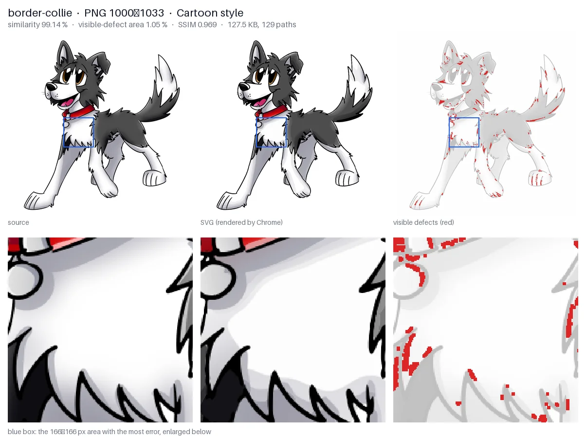</p>
<p>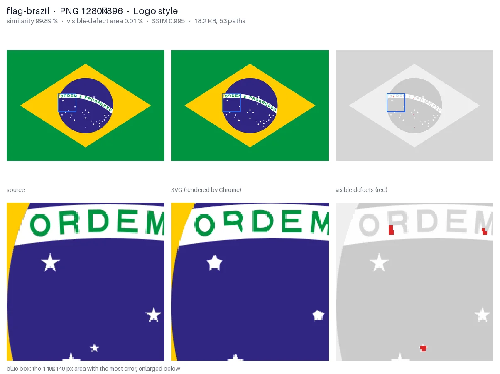</p>
<p>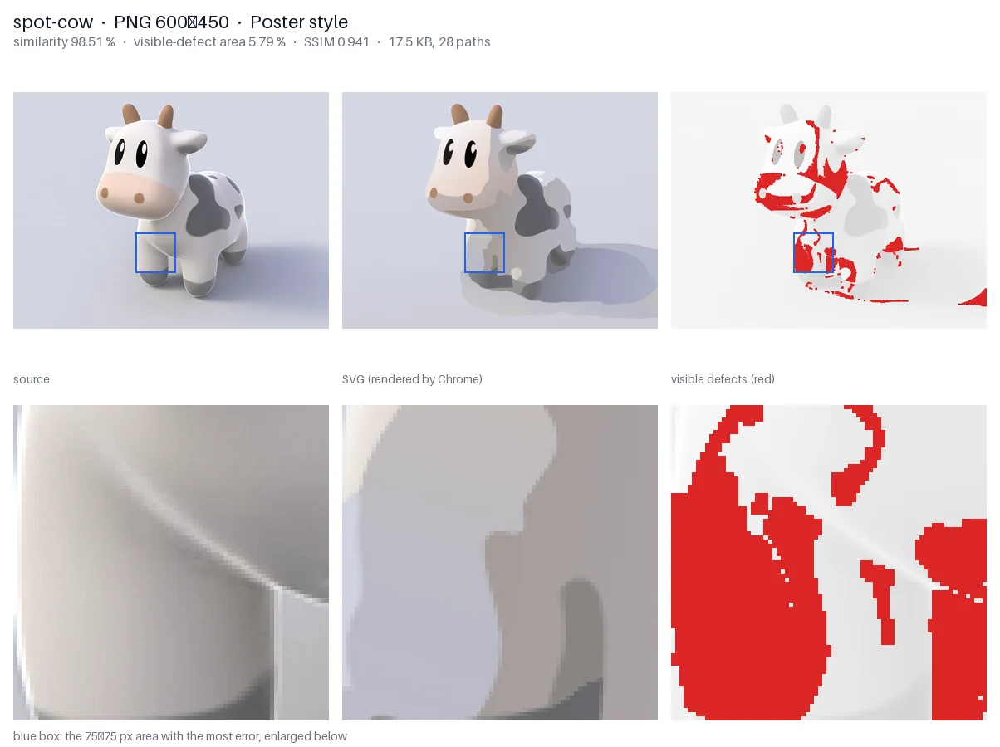</p>
<p>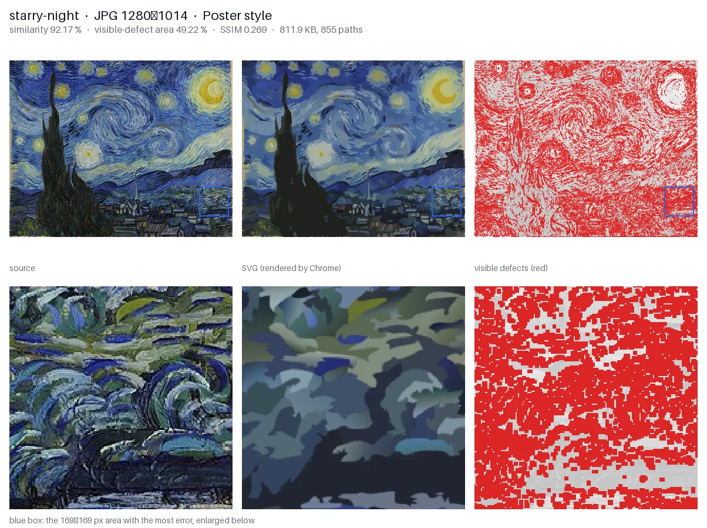</p>

</details>

---

## Benchmark

**45 pictures, every one used, none picked.** Two license-free sets from Wikimedia Commons (CC0 / public domain,
SHA-256 checked, downloaded on demand):

- **E7**, 27 pictures: renders of vector art (cartoons, flat illustrations, flags, icons), the cleanest possible
  input, plus 3 photos and paintings.
- **E8**, 18 pictures made as rasters: PNGs from 300 px, JPEG clipart, pixel art, glossy icons, and two hard cases
  (a 3D render, a photo-like saxophone).

Each picture gets the style a user would pick for its kind (cartoon → Cartoon, icon → Logo, …). Pictures in another
style are also run with Cartoon, the one style for everything (last column of the full tables). The SVG is rendered
by Chrome and compared with the source.

| Set | Group | Images | Median similarity | Median defect area | Worst defect area | Median SSIM | Median size |
|---|---|---|---|---|---|---|---|
| E7 | flat art (icons, flags, flat, cartoon, pixel) | 24 | 99.81% | 0.05% | 0.89% | 0.993 | 38 KB |
| E7 | photos, paintings, 3D renders | 3 | 92.73% | 22.39% | 49.22% | 0.472 | 538 KB |
| E8 | flat art (icons, flags, flat, cartoon, pixel) | 16 | 99.40% | 0.34% | 11.46% | 0.981 | 27 KB |
| E8 | photos, paintings, 3D renders | 2 | 97.08% | 7.58% | 9.37% | 0.894 | 68 KB |

**How to read it.**

- **Similarity** is the app's score: 100 − the mean color error. It is high for almost any decent result.
- **Visible-defect area** is the share of the picture where the SVG differs clearly from the source (CIEDE2000 > 5),
  not counting the 1–2 px anti-aliasing lines along edges. A lost color or a missing shape shows here with its full
  area. 0.15 % on a 1280 px picture is a few scattered pixels; 5 % is something you notice.
- **SSIM** is the standard structural similarity (1 = identical).

<p align="center">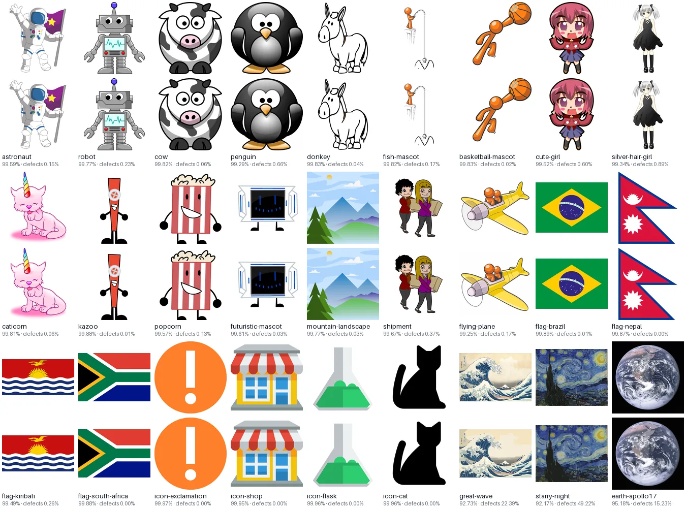</p>
<p align="center">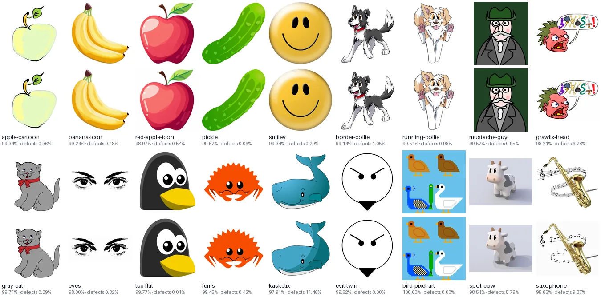</p>

<details>
<summary><b>Every picture: E7 (renders of vector art)</b></summary>

| Image | Kind | Style | Similarity | Defect area | PSNR | SSIM | Size | Paths | Time | Cartoon style |
|---|---|---|---|---|---|---|---|---|---|---|
| astronaut (PNG, 1280×1547) | cartoon | Cartoon | 99.59% | 0.15% | 30.1 dB | 0.990 | 98 KB | 56 | 9.8 s | same |
| robot (PNG, 1280×1509) | cartoon | Cartoon | 99.77% | 0.23% | 35.6 dB | 0.991 | 69 KB | 57 | 9.5 s | same |
| cow (PNG, 1280×1449) | cartoon | Cartoon | 99.82% | 0.06% | 35.8 dB | 0.995 | 34 KB | 31 | 7.3 s | same |
| penguin (PNG, 1280×1283) | cartoon | Cartoon | 99.29% | 0.66% | 33.6 dB | 0.950 | 88 KB | 103 | 11.5 s | same |
| donkey (PNG, 1280×1811) | cartoon | Cartoon | 99.83% | 0.04% | 34.7 dB | 0.992 | 44 KB | 18 | 8.1 s | same |
| fish-mascot (PNG, 1280×2846) | cartoon | Cartoon | 99.82% | 0.17% | 34.8 dB | 0.994 | 58 KB | 63 | 15.4 s | same |
| basketball-mascot (PNG, 1280×1280) | cartoon | Cartoon | 99.83% | 0.02% | 38.9 dB | 0.995 | 68 KB | 74 | 7.8 s | same |
| cute-girl (PNG, 1280×2054) | cartoon | Cartoon | 99.52% | 0.60% | 31.9 dB | 0.982 | 174 KB | 210 | 14.0 s | same |
| silver-hair-girl (PNG, 1280×1811) | cartoon | Cartoon | 99.34% | 0.89% | 29.4 dB | 0.972 | 153 KB | 115 | 11.5 s | same |
| caticorn (PNG, 1280×1527) | cartoon | Cartoon | 99.81% | 0.06% | 38.8 dB | 0.993 | 92 KB | 70 | 8.2 s | same |
| kazoo (PNG, 1280×1368) | cartoon-raster | Cartoon | 99.88% | 0.01% | 38.9 dB | 0.997 | 12 KB | 20 | 6.0 s | same |
| popcorn (PNG, 1200×1200) | cartoon-raster | Cartoon | 99.57% | 0.13% | 34.6 dB | 0.984 | 33 KB | 36 | 6.0 s | same |
| futuristic-mascot (PNG, 1280×960) | cartoon-raster | Cartoon | 99.61% | 0.03% | 36.6 dB | 0.992 | 24 KB | 41 | 4.7 s | same |
| mountain-landscape (PNG, 1280×1279) | flat | Flat illustration | 99.77% | 0.03% | 40.0 dB | 0.993 | 41 KB | 47 | 7.9 s | 99.76% · 0.07% · 68 KB |
| shipment (PNG, 1280×1477) | flat | Flat illustration | 99.67% | 0.37% | 35.7 dB | 0.981 | 86 KB | 95 | 7.7 s | 99.67% · 0.28% · 91 KB |
| flying-plane (PNG, 1280×1098) | flat | Flat illustration | 99.25% | 0.17% | 33.9 dB | 0.986 | 56 KB | 75 | 6.4 s | 99.72% · 0.17% · 61 KB |
| flag-brazil (PNG, 1280×896) | logo | Logo (background kept) | 99.89% | 0.01% | 34.7 dB | 0.995 | 18 KB | 53 | 3.1 s | 99.86% · 0.04% · 32 KB |
| flag-nepal (PNG, 1280×1561) | logo | Logo (background kept) | 99.87% | 0.00% | 34.4 dB | 0.988 | 2.4 KB | 6 | 4.5 s | 99.92% · 0.00% · 8.7 KB |
| flag-kiribati (PNG, 1280×640) | logo | Logo (background kept) | 99.49% | 0.26% | 26.5 dB | 0.968 | 18 KB | 21 | 2.0 s | 99.26% · 0.23% · 55 KB |
| flag-south-africa (PNG, 1280×854) | logo | Logo (background kept) | 99.88% | 0.00% | 34.8 dB | 0.995 | 0.8 KB | 7 | 3.4 s | 99.76% · 0.00% · 6.4 KB |
| icon-exclamation (PNG, 960×960) | icon | Logo | 99.97% | 0.00% | 43.5 dB | 0.999 | 0.8 KB | 3 | 1.3 s | 99.92% · 0.00% · 3.3 KB |
| icon-shop (PNG, 960×960) | icon | Logo | 99.95% | 0.00% | 40.6 dB | 0.995 | 6.2 KB | 49 | 6.1 s | 99.81% · 0.02% · 33 KB |
| icon-flask (PNG, 960×960) | icon | Logo | 99.96% | 0.00% | 39.5 dB | 0.996 | 1.4 KB | 6 | 2.1 s | 99.96% · 0.01% · 6.8 KB |
| icon-cat (PNG, 960×960) | icon | Logo | 99.96% | 0.00% | 39.8 dB | 0.999 | 1.5 KB | 1 | 1.5 s | 99.97% · 0.00% · 2.5 KB |
| great-wave (JPG, 1280×860) | poster | Poster | 92.73% | 22.39% | 17.7 dB | 0.472 | 289 KB | 319 | 7.6 s | 94.27% · 22.34% · 619 KB |
| starry-night (JPG, 1280×1014) | poster | Poster | 92.17% | 49.22% | 19.6 dB | 0.269 | 812 KB | 855 | 16.4 s | 92.06% · 48.03% · 1905 KB |
| earth-apollo17 (JPG, 1280×1281) | poster | Poster | 95.18% | 15.23% | 21.6 dB | 0.616 | 538 KB | 476 | 12.5 s | 94.94% · 15.36% · 1167 KB |

</details>

<details>
<summary><b>Every picture: E8 (pictures made as rasters)</b></summary>

| Image | Kind | Style | Similarity | Defect area | PSNR | SSIM | Size | Paths | Time | Cartoon style |
|---|---|---|---|---|---|---|---|---|---|---|
| apple-cartoon (PNG, 300×300) | cartoon | Cartoon | 99.34% | 0.36% | 29.7 dB | 0.983 | 23 KB | 48 | 2.1 s | same |
| banana-icon (PNG, 512×512) | cartoon | Cartoon | 99.24% | 0.18% | 33.8 dB | 0.968 | 42 KB | 65 | 2.1 s | same |
| red-apple-icon (PNG, 512×512) | cartoon | Cartoon | 98.97% | 0.54% | 33.1 dB | 0.959 | 30 KB | 52 | 1.4 s | same |
| pickle (PNG, 500×485) | cartoon | Cartoon | 99.57% | 0.06% | 34.5 dB | 0.984 | 24 KB | 39 | 2.9 s | same |
| smiley (PNG, 1178×1157) | cartoon | Cartoon | 99.34% | 0.29% | 35.9 dB | 0.980 | 96 KB | 73 | 6.7 s | same |
| border-collie (PNG, 1000×1033) | cartoon | Cartoon | 99.14% | 1.05% | 28.8 dB | 0.969 | 127 KB | 129 | 6.7 s | same |
| running-collie (PNG, 1550×2254) | cartoon | Cartoon | 99.51% | 0.98% | 30.4 dB | 0.986 | 237 KB | 185 | 17.3 s | same |
| mustache-guy (PNG, 494×573) | cartoon | Cartoon | 99.57% | 0.95% | 33.0 dB | 0.987 | 18 KB | 17 | 1.3 s | same |
| grawlix-head (JPG, 1847×1156) | cartoon | Cartoon | 98.21% | 6.78% | 28.1 dB | 0.906 | 691 KB | 1217 | 21.8 s | same |
| gray-cat (JPG, 1760×1920) | cartoon | Cartoon | 99.71% | 0.09% | 36.3 dB | 0.990 | 93 KB | 36 | 13.9 s | same |
| eyes (JPG, 1919×782) | cartoon | Cartoon | 98.00% | 0.32% | 21.9 dB | 0.916 | 176 KB | 39 | 8.1 s | same |
| tux-flat (PNG, 512×512) | icon | Logo | 99.77% | 0.01% | 33.7 dB | 0.988 | 4.9 KB | 9 | 1.5 s | 99.59% · 0.13% · 9.4 KB |
| ferris (PNG, 460×307) | icon | Logo | 99.45% | 0.42% | 26.8 dB | 0.972 | 4.2 KB | 12 | 0.7 s | 99.39% · 0.05% · 13 KB |
| kaskelix (PNG, 512×512) | icon | Logo | 97.91% | 11.46% | 25.6 dB | 0.962 | 10 KB | 16 | 3.4 s | 99.32% · 0.01% · 15 KB |
| evil-twin (PNG, 330×371) | icon | Logo (background kept) | 99.62% | 0.00% | 29.7 dB | 0.992 | 2.2 KB | 9 | 0.3 s | 99.58% · 0.00% · 9.5 KB |
| bird-pixel-art (PNG, 512×512) | pixel | Pixel art (background kept) | 100.00% | 0.00% | inf dB | 1.000 | 14 KB | 165 | 2.7 s | 99.69% · 0.10% · 32 KB |
| spot-cow (PNG, 600×450) | poster | Poster | 98.51% | 5.79% | 30.5 dB | 0.941 | 17 KB | 28 | 1.1 s | 98.79% · 1.01% · 32 KB |
| saxophone (JPG, 824×721) | poster | Poster | 95.65% | 9.37% | 19.0 dB | 0.848 | 118 KB | 235 | 3.1 s | 97.78% · 5.41% · 264 KB |

</details>

### Where it is not good (yet)

- **Photos and paintings**: 92–98 % similarity but 6–49 % visible defects, and files up to 0.8 MB (1.9 MB with
  Cartoon). Continuous texture has
  no flat regions to find. For such pictures an SVG is rarely the right format.
- **A gradient in the Logo style** (the shaded whale `kaskelix`): 11.6 % defects, because the Logo style draws flat
  colors only. The app now warns and suggests Cartoon, which gets 0.01 %.
- **A scanned marker drawing** (`grawlix-head`, JPEG): 6.8 % defects and 691 KB. The textured dark-red outlines
  become black ink and the marker texture becomes bands.
- **Tiny details in the Logo style**: the stars of the Brazilian flag come out slightly rounded (the vision judge:
  8/10). Details of 1–4 px are the open problem of the Logo style ([technical report](docs/research.md) §8.5).
- **Shaded cartoons and shrunk pictures, against VTracer**: VTracer's many small layers leave fewer visible defects
  on 15 of 45 pictures (mostly shaded cartoons and photos) and on shrunk pictures, at 3–5× the file size.
  VTracer is also about 20× faster (see below).

### A second opinion from a vision model

The pixel scores say how much differs, not whether a person would notice. So every result was also shown to
a vision-language model (**nvidia/nemotron-3.5-super-vl-120b-a12b**, NVIDIA NIM), next to its source with the worst area enlarged, and it was
asked to list the defects it sees and to score the copy 0–10 (3 runs per pair, temperature
0.3; prompt and answers in `bench/results/judge.json`).

**Is the judge trustworthy?** It was first given pairs with a known answer:

| Control pair | Expected | Scores (3 runs) |
|---|---|---|
| identical: `cow` | identical (expect 10) | 10, 10, 10 |
| identical: `tux-flat` | identical (expect 10) | 10, 10, 10 |
| identical: `starry-night` | identical (expect 10) | 9, 8, 9 |
| erased: `icon-shop` | a part erased (expect <= 5) | 4, 4, 4 |
| hue: `border-collie` | colors shifted (expect <= 5) | 4, 6, 6 |
| posterized: `shipment` | 3 colors per channel (expect <= 6) | 4, 4, 4 |

**Results** (median of the runs; 10 = no visible difference, 8–9 = only in the enlargement):

| Set | Group | Pictures | Median score | Lowest | Scored 9 or 10 |
|---|---|---|---|---|---|
| E7 | flat art | 24 | 9 | 6 | 18 of 24 |
| E7 | photos, paintings, renders | 3 | 4 | 4 | 0 of 3 |
| E8 | flat art | 16 | 9 | 7 | 13 of 16 |
| E8 | photos, paintings, renders | 2 | 5 | 3 | 0 of 2 |

**What it adds.** Over all pictures its ranking agrees with the pixel metrics about equally (Spearman: similarity
0.67, SSIM 0.697, visible-defect area 0.679); on flat art alone the agreement is
moderate (0.529, 0.567, 0.543). So no single number replaces looking.
What the judge adds is *naming* small details that matter to a person but cover few pixels. In the first run it
scored the Brazilian flag 4/10 for its missing stars and motto, while the visible-defect area was only 0.52 % (that
metric ignores details under 3 px). This led to a fix (smaller speck limit in the Logo style, technical report
§7.3); the flag now scores 8/10. It also confirmed the other fixes: a line drawing whose ring 1.6 cut into pieces scores
10/10, the robot whose grey pupil had turned black 9/10. It still names the feather lines of a flag's bird (6/10). Its runs agreed closely (median spread 0 points; every answer was valid).
The pictures it scored 7 or lower, and why:

| Picture | Judge | Similarity | Defect area | What the judge saw (first run) |
|---|---|---|---|---|
| E8 `saxophone` | 3 | 95.65 % | 9.37 % | Staff lines broken into disconnected fragments; Musical notes distorted into grey blobs |
| E7 `great-wave` | 4 | 92.73 % | 22.39 % | Lost fine details in the boat structure and figures; Merged water colors and lost foam texture |
| E7 `starry-night` | 4 | 92.17 % | 49.22 % | Lost fine brushstroke texture and detail; Colors merged into large flat regions |
| E7 `earth-apollo17` | 4 | 95.18 % | 15.23 % | Fine cloud and ocean textures replaced by large flat color regions; Smooth gradients posterized into stepped bands |
| E7 `flag-kiribati` | 6 | 99.49 % | 0.26 % | Missing internal feather texture lines on the bird; Stray blue pixel artifacts on the bird |
| E8 `kaskelix` | 7 | 97.91 % | 11.46 % | Slight color/gradient mismatch on the rear body (darker patch in B); Minor outline artifact/irregularity visible in the enlarged area |
| E8 `spot-cow` | 7 | 98.51 % | 5.79 % | blocky gradients instead of smooth shading; faceted surfaces instead of smooth curves |

### Small pictures and the optional AI step

Ten E7 pictures shrunk to 256 px, three ways: the old 1× grid, the new 2× grid (default under 512 px), and the
optional local AI step (Real-ESRGAN). Cells: similarity · visible defects · size.

| Image (256 px) | Style | 1× grid (before 1.7) | 2× grid (default) | AI + 2× |
|---|---|---|---|---|
| astronaut | Cartoon | 97.05% · 0.72% · 11 KB | 97.52% · 0.80% · 25 KB | 97.68% · 0.15% · 15 KB |
| cow | Cartoon | 97.67% · 1.04% · 17 KB | 98.16% · 0.79% · 24 KB | 98.76% · 0.10% · 14 KB |
| penguin | Cartoon | 97.64% · 1.47% · 33 KB | 97.99% · 1.19% · 46 KB | 98.38% · 0.89% · 39 KB |
| fish-mascot | Cartoon | 97.49% · 4.15% · 5.4 KB | 98.45% · 1.59% · 12 KB | 98.23% · 0.75% · 7.2 KB |
| shipment | Flat illustration | 97.52% · 5.38% · 18 KB | 98.07% · 3.79% · 35 KB | 98.57% · 1.36% · 25 KB |
| flag-nepal | Logo | 99.01% · 0.00% · 2.0 KB | 99.01% · 0.00% · 2.0 KB | 98.68% · 0.00% · 1.9 KB |
| flag-south-africa | Logo | 99.24% · 0.00% · 0.8 KB | 99.24% · 0.00% · 0.8 KB | 99.21% · 0.00% · 0.8 KB |
| icon-shop | Logo | 98.25% · 4.01% · 5.7 KB | 98.25% · 4.01% · 5.7 KB | 97.91% · 0.46% · 11 KB |
| icon-flask | Logo | 99.77% · 0.06% · 1.1 KB | 99.77% · 0.06% · 1.1 KB | 99.47% · 1.06% · 3.3 KB |
| icon-cat | Logo | 99.63% · 0.09% · 0.6 KB | 99.63% · 0.09% · 0.6 KB | 99.55% · 0.00% · 0.8 KB |
| **median, Cartoon / Flat** | | **97.52% · 1.47%** | **98.07% · 1.19%** | **98.38% · 0.75%** |
| **median, Logo** | | **99.24% · 0.06%** | **99.24% · 0.06%** | **99.21% · 0.00%** |

The AI step cuts the visible defects of small cartoons by more than half, and makes the files smaller. On small PNG
logos the result is mixed (the shop icon gets better, the flask worse, the median stays) while the time triples, so
the app's *Automatic* AI mode uses it with the Logo style only for JPEGs, where it removes the compression blocks
(next section), and never for Pixel art; *Always* still applies it. The Logo style has its own 2× trace under
256 px, so its 1× and 2× columns are the same. Why the AI step exists, why it is optional, and the related research:
[technical report](docs/research.md) §3.3.

### Against other tracers

The same 45 pictures through **VTracer** 0.6.15 (its defaults, and its high-detail settings) and **Potrace** (8
colors stacked, the way Inkscape traces colors), scored the same way (`bench/compare_tools.py`):

| Tool | Median similarity | Median visible defects | Median size | Median time |
|---|---|---|---|---|
| **this project** | **99.57 %** | **0.17 %** | **41 KB** | 6.1 s |
| VTracer, defaults | 98.90 % | 0.40 % | 143 KB | 0.28 s |
| VTracer, high detail | 99.03 % | 0.19 % | 219 KB | 0.32 s |
| Potrace, 8 colors | 98.13 % | 9.54 % | 307 KB | (Python port) |

**Is the difference real?** Paired statistics over the same pictures (Wilcoxon signed-rank test, bootstrap 95 %
confidence intervals; `bench/stats.py`):

- vs. VTracer (high detail): higher similarity on 38 of 45 pictures (median +0.45 points, 95 % CI +0.38 to +0.57,
  p < 0.001) with files 5× smaller on all 45. The visible-defect area is **not** significantly different over all
  pictures (p = 0.31); on flat art alone it is lower (24 wins, 10 losses, p = 0.012).
- vs. 1.6.0: no picture lower in similarity, 21 higher (p < 0.001); visible defects lower on 15, higher on 2.

### Damaged pictures

Ten flat-art pictures compressed, shrunk and made noisy, each result compared with the **clean** original
(`bench/robustness.py`). Median similarity · visible-defect area:

| Damage | This project | + AI step | VTracer |
|---|---|---|---|
| none | 99.69 % · 0.10 % | 99.38 % · 0.04 % | 99.00 % · 0.14 % |
| JPEG quality 30 | 99.25 % · 1.14 % | 99.33 % · 0.06 % | 98.73 % · 1.86 % |
| shrunk to 50 % | 99.11 % · 1.46 % | 99.17 % · 0.67 % | 98.33 % · 0.82 % |
| noise σ 16 | 97.83 % · 0.41 % | 99.01 % · 0.11 % | 97.27 % · 5.17 % |

Noise used to break the Logo style (a flag under strong noise: 37 % visibly wrong); it is now estimated from the
picture and smoothed away first, with clean pictures untouched. On damaged input the optional AI step pays off.
All conditions and the method: [technical report](docs/research.md) §5.5–§5.7.

### Reproduce

```bash
pip install -e ".[dev]"
python bench/fetch_sets.py && python bench/fetch_sets.py --set real   # the 45 pictures
python bench/readme.py                         # tables -> bench/results/readme.md (+ --models DIR for the AI column)
python bench/evidence.py                       # the pictures above
mkdir old && git archive v1.6.0 src | tar -x -C old && python bench/before_after.py --old old
NVIDIA_API_KEY=... python bench/judge.py       # optional vision-model review
pip install vtracer==0.6.15 potracer==0.0.4 && python bench/compare_tools.py   # other tracers (benchmark only)
python bench/versions.py --old old && python bench/stats.py && python bench/robustness.py --models MODELS_DIR
```

Measured on Intel64 Family 6 Model 141 Stepping 1, GenuineIntel, Windows 11, Chrome for rendering, one process. Times and the second decimal vary between machines and
browser versions. Method, metrics, related work and every fixed error: **[technical report](docs/research.md)**.

---

## What it does

Turn **raster cartoon illustrations, logos, icons and pixel art** (PNG/WebP/JPEG — e.g. from image generators or scans) into **editable, library-free SVG**:

- **Gradient fills** — soft shading becomes one region with a fitted `linearGradient`, and round shading (balls,
  blush, glows) one elliptical `radialGradient` — not posterized bands or blotches.
- **Crisp outlines** — ink lines are separated by color unmixing into a sub-pixel accurate, smooth outline layer.
- **Pure SVG** — only `<path>`, `<rect>`, `<g>`, `<linearGradient>`, `<radialGradient>`. No `<image>`, CSS or scripts. Works in browsers,
  Figma/Illustrator/Inkscape, Flutter (`flutter_svg`), Android/iOS vector pipelines.
- **Safe to inline** — gradient ids are prefixed per file, so many SVGs can share one page.
- **Compact** — relative path commands with minimal number syntax (~50% smaller than absolute coordinates).
- **Optional AI clean-up** (app, v1.3+) — small, blurry or JPEG pictures can be enhanced by a local Real-ESRGAN
  model (downloaded on request, runs on the GPU or CPU) before tracing.

```text
input.png ──► outline separation ──► fill layer (regions + gradients) ──► SVG
               (ink alpha map)        (segmentation, union-find merge)    <defs> gradients
                                                                          <g id="fill">
                                                                          <g id="outline">
```
- **Logo / icon engine** — one path per shape, straight lines, sharp corners, no background, tiny files; **pixel art** traced exactly ([logo engine](docs/logo-engine.md)).

> **Status:** v1.7 — desktop app for **Windows and macOS**, local web UI, command line and Python library. The benchmark above is measured on this version.

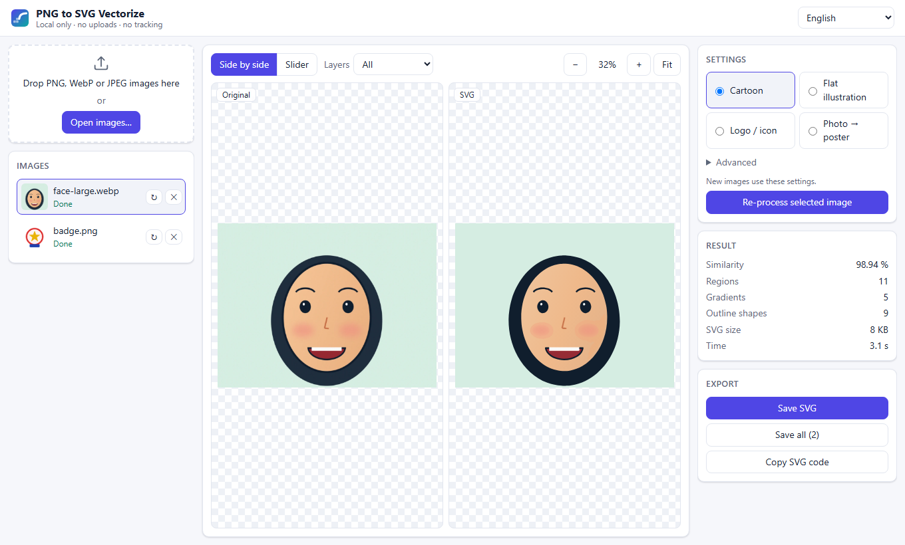

## Install

```bash
git clone https://github.com/RidhuanDEV/png-to-svg-vectorize.git
cd png-to-svg-vectorize
pip install -e .            # add [dev] for tests
```

Requirements: Python ≥ 3.11, numpy, scipy, Pillow. No native tracer: curve fitting is built in.

## Usage

```bash
png2svg hero.png                         # -> hero.svg
png2svg scenes/*.png -o out/ --report    # batch + similarity check (needs Chrome or Edge)
png2svg logo.png --preset logo           # flat colors, crisp geometry (also: flat, poster, cartoon)
png2svg scenes/*.png -o out/ -j 8        # 8 worker processes (default: min(4, CPUs))
png2svg logo.png -o logo.pdf --max-colors 4 --remove-bg   # PDF / EPS / DXF too; flat palette, no background
png2svg art/*.png -o out/ --profile brand.pngsvg-profile.json   # a style profile saved from the app
png2svg sketch.png -o sketch.dxf --centerline   # line art as center-line strokes (plotters, laser)
png2svg watch inbox/ out/ -f pdf               # convert pictures as they appear in a folder
```

| Preset | For |
|---|---|
| `cartoon` (default) | character art with ink outlines and soft shading |
| `flat` | flat illustration: solid shapes, only clear gradients |
| `logo` | logos and icons: one path per shape, straight edges, sharp corners, transparent background ([logo engine](docs/logo-engine.md)) |
| `poster` | photos/paintings → poster look: fewer, larger regions |
| `pixel` | pixel art: follows the pixel grid exactly |

```python
from PIL import Image
from pngsvg import Options, options_for, vectorize

result = vectorize(Image.open('hero.png'), Options(id_prefix='hero'))
# or a preset: options_for('logo', id_prefix='hero'); parallel fitting: vectorize(img, opts, executor=pool)
open('hero.svg', 'w', encoding='utf-8').write(result.svg)
print(result.regions, result.gradients, result.outline_paths)
```

### Options

| Option | Default | Meaning |
|---|---|---|
| `scale` | auto (long side ≈ 4500 px) | outline upscale for sub-pixel tracing |
| `tolerance` | `0.5` | max curve deviation of fill boundaries (px); higher = smaller file |
| `smooth` | `1.5` | fill boundary smoothing (px) |
| `hidden_tolerance` | `3` | looser tolerance where a fill boundary is hidden under the outline layer |
| `outline_tolerance` | `0.35` | max curve deviation of outlines (px) |
| `outlines` | `True` | separate ink outlines into their own layer |
| `gradients` | `True` | gradient fills (`False` = flat colors) |
| `radial` | `True` | allow elliptical radial gradients |
| `subpixel` | `True` | place fill boundaries at their sub-pixel edge position (from anti-aliasing) |
| `regions.merge_de` | `9` | neighbours closer than this ΔE may merge (soft shading). Lower keeps more detail |
| `regions.fit_de` | `3.5` | ...only if one linear gradient still explains the union (extra error per px, ΔE) |
| `regions.gradient_min_area` | `300` | smaller regions are always solid fills |
| `outline.core_de` | `9` | ΔE to the ink color for pure outline pixels |
| `outline.thin_depth` | `25` | thin anti-aliased lines: how much darker (L\*) than surroundings |
| `outline.halo_*` | — | flattening of light rims left by over-sharpened generators |

## How it works

1. **Ink detection.** The ink color is the median of the darkest pixels. Pure ink = close to it (ΔE), very dark,
   or a *thin* dark line (black top-hat) of ink-like hue — so 1–2 px lines that never reach full ink still count.
   Ink is a stroke: each stroke keeps its own ink color (up to three inks, so grey lines stay grey), and a dark
   part wider than a stroke with shading of its own (a reflection, light in hair) stays a color.
2. **Unmixing.** Around ink, each pixel is modelled as `alpha·ink + (1−alpha)·behind`. Pixels on that segment are
   anti-aliasing (alpha = position); pixels off it are real colors (lips, blush). The continuous alpha map is
   upsampled and thresholded → smooth outline with sub-pixel accuracy. Light same-hue rims next to ink
   (sharpening halos) are flattened.
3. **Regions.** The image without ink is edge-preserving smoothed (guided filter), palette-reduced and split into
   connected regions, then merged with a union-find: similar neighbours **only if one linear gradient still
   explains their union** (evaluated in O(1) from per-region sufficient statistics), tiny regions, and thin rims
   hugging outlines. So skin shading merges, while rings, blush and patterns stay separate.
4. **Gradients.** Per region: a linear model (direction of strongest change) and, for blob shading, an
   elliptical cone (center and ellipse refined by non-linear least squares). Stop colors at 0/.5/1 are solved by
   least squares against exactly what a renderer draws. Radial is used when it is clearly better; gradients that
   barely beat a solid color become solid. Concentric bands of a ball or glow are first grown back into one
   region.
5. **Sub-pixel edges.** Boundary pixels shifted by the segmentation filters are moved back to the label their
   own color belongs to, and each boundary crack is placed where the anti-aliasing says the edge is
   (`e = a_left + a_right − 1`), so straight edges stay straight and tips stay sharp.
6. **Shared boundaries.** The region label image becomes a planar map: every boundary between two regions is a
   chain between junctions, smoothed and fitted **once** and used by both regions, so neighbours never gap or
   overlap. Each region is painted as its outer boundary (holes are covered by the regions inside), largest
   first; a thin same-color stroke hides anti-aliasing seams.
7. **Curve fitting.** Chains are fitted with least-squares cubic Beziers (Schneider's algorithm) within a pixel
   tolerance, splitting at sharp corners. Boundaries hidden under the ink get a much looser tolerance. The
   outline is traced the same way from its sub-pixel mask. Paths use relative commands and minimal numbers.

## Web UI (local)

```bash
pip install -e ".[app]"
cd app/ui && npm ci && npm run build && cd ../..   # builds the UI into src/pngsvg_app/static
png2svg serve                                     # opens http://127.0.0.1:<port>/#t=<session token>
```

Add photos (drag them in or **Choose photos**) — they wait on a workbench until you tick the ones you want and press
**Process**; they are then converted in a queue that spares the computer (speed: Automatic / Saver / Balanced / Fast,
low-priority workers). Compare original and SVG side by side or with a slider (synchronized zoom up to 800 %,
fills-only / outlines-only views), see a similarity score, change the style and process again, then save one SVG, all
SVGs (zip) or copy the SVG code. Custom, keyboard-accessible components; a skippable first-run guide; English and
Bahasa Indonesia; light/dark follows the system.

Privacy and safety: the service listens on `127.0.0.1` only, every API call needs the random per-session token
from the link, foreign `Host` headers are refused, uploads are limited to 50 MB / 8000 px and checked by content
(PNG, WebP, JPEG). Images and results stay in memory and are gone when the server stops.

UI development: `python -m pngsvg_app --port 8765 --token dev --no-browser`, then `npm run dev` in `app/ui` and
open `http://localhost:5173/#t=dev`.

## Desktop app

Installers are produced by the `Release` workflow: `PNG-to-SVG-Vectorize-Setup-x.y.z.exe` (Windows 10/11 x64,
per-user, no admin rights) plus a portable zip, and `PNG-to-SVG-Vectorize-x.y.z-arm64.dmg` / `-x64.dmg` (macOS 12+).
The builds are **not code-signed** (free, open source): Windows SmartScreen shows "Windows protected your PC" → *More
info* → *Run anyway*; on macOS open the app once with right-click → *Open* (or System Settings → Privacy & Security →
*Open Anyway*).

The app is the same UI in a native window (WebView2 / WKWebView) with native open/save dialogs. Everything runs on
the computer; the local service only listens on `127.0.0.1` with a per-session token.

From source: `pip install -e ".[desktop]"`, build the UI (see above), then `pngsvg-app`. Build the bundle with
`pip install -r packaging/requirements-build.txt && pyinstaller --noconfirm packaging/pngsvg.spec`;
`"dist/PNG to SVG Vectorize/PNG to SVG Vectorize.exe" --smoke` checks it (vectorizes one image, exit code 0).

## Quality check

`--report` renders the SVG with headless Chrome/Edge and prints similarity (100 − mean abs error %, and % of
pixels within 24/255). Typical cartoon illustrations reach 98–99 %. **A high similarity can still hide a visible
defect** (see [Before and after](#before-and-after)): check the visible-defect area with
`pngsvg.compare.defect_area(source, rendered)` and look at the result at 2× zoom.

## Limitations

- Designed for **cartoon / flat illustration** styles with ink outlines. Photos and painterly art produce many
  regions and large files.
- Linear and elliptical radial gradients only (no mesh gradients): glossy, strongly non-linear shading may show
  a few soft bands. Very faint tiny color spots may merge into their surroundings.
- Up to three ink colors per image; hairlines thinner than ~1.5 px that are mostly anti-aliasing can be lost.
- Transparent images are flattened onto white (the SVG has a background).
- File size grows with detail (≈ 100–400 KB for a 1536×1024 detailed scene).

## Tests

```bash
pip install -e ".[dev,app]"
pytest -q                                   # engine + API tests
cd app/ui && npm run check && npm run e2e   # UI type check + Playwright end-to-end tests (needs a UI build)
```

## FAQ

**Is 99 % similarity good?** It is necessary, not sufficient. Nearly every result of a decent tracer scores above
98 %, because most of a picture is flat and easy. Look at the visible-defect area and at the pictures: that is
where a merged color or a missing shape shows.

**Why not 99.9 %?** 99.9 % means a mean error of 0.26 levels of 255. On flat art with edges that is about the
difference between two browsers drawing the *same* SVG. The icons reach 99.95 %; pictures with many edges and
anti-aliasing stop near 99.5–99.9 %.

**Does it use AI?** Only if you ask. The tracer is classic image processing (no neural network). An optional local
Real-ESRGAN model can clean small or JPEG pictures first. It is downloaded on request and runs on your computer.
The benchmark judge is a separate, optional script that sends the license-free benchmark pictures to NVIDIA NIM;
the app never does.

**Is my picture uploaded anywhere?** No. Everything runs locally; the web UI listens on `127.0.0.1` only.

**Which style should I pick?** Cartoon for characters with outlines and shading, Flat illustration for flat scenes,
Logo for logos and icons (flat colors), Pixel art for sprites, Poster for photos. The app says when a picture does
not suit the Logo style.

**Can I use it commercially?** Yes, under the AGPL-3.0: forks and services built on it must stay open source and
keep the attribution (see [License](#license)).

## Roadmap

See [docs/PLAN.md](docs/PLAN.md). Done: own curve fitting and shared boundaries (v0.2), radial
gradients, parallel processing and presets (v0.3) — see [docs/bench.md](docs/bench.md) — and a local web UI
(v0.4), desktop app + installers (v0.5), user guide and license-free comparison set (v1.0).

## License

[GNU AGPL-3.0](LICENSE) © Ridhuan Rangga Kusuma — see [NOTICE](NOTICE).

You may use, change and share this program, also commercially, as long as every copy and every modified version
(including one offered as a web service) stays open source under the same license, and keeps the attribution
**"Based on PNG to SVG Vectorize by Ridhuan Rangga Kusuma"** with a link to this repository (additional terms
under AGPL section 7, in NOTICE). Releases 1.0.0–1.5.0 were published under the MIT License.

---

## Ringkasan (Bahasa Indonesia)

Alat untuk mengubah **ilustrasi kartun raster** (PNG/WebP/JPEG) menjadi **SVG path murni** yang bisa diedit:
isian bergradasi (kulit mulus, tanpa bercak), garis luar tajam dan akurat sampai sub-piksel, tanpa library/CSS/raster,
ID gradien unik per file, dan ukuran ringkas. Pemakaian: `png2svg gambar.png` (hasil `gambar.svg`),
atau `png2svg folder/*.png -o hasil/ --report` untuk banyak berkas sekaligus beserta ukuran kemiripan.
Selalu periksa juga secara visual pada perbesaran 2×:
kemiripan 99 % bisa menyembunyikan cacat yang terlihat, maka benchmark di atas juga melaporkan luas cacat terlihat
dan menampilkan gambarnya (45 gambar berlisensi bebas, laporan teknis di [docs/research.md](docs/research.md)). Antarmuka lokal: `pip install -e ".[app]"`, build UI di
`app/ui` (`npm ci && npm run build`), lalu `png2svg serve` — seret gambar, bandingkan, simpan SVG; semua tetap di
komputer Anda.
