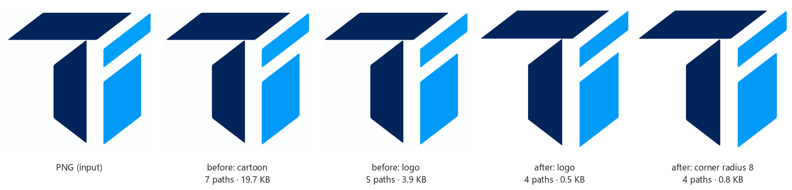

# Logo engine (styles *Logo / icon* and *Pixel art*)

Flat artwork — logos, icons, marks, pixel art — needs a different result than illustrations: one clean path per shape,
straight edges, sharp corners, no background, a few hundred bytes. Since 1.6 the `logo` and `pixel` presets use
the flat engine in `src/pngsvg/logo.py`; the other presets keep the region engine (gradients, ink layer).

## Pipeline

Every stage is a pure function on explicit types; the same picture and options give a byte-identical SVG.

| Stage | Function | Input → output |
|---|---|---|
| 1. Load | `load` | PIL image → RGB float (composited on white), opacity or `None`, trace scale (2× under 256 px; never for pixel art) |
| 2. Background | `background` | RGB, opacity → `Background(mask, color)`: transparent pixels (opacity < `alpha_threshold`), else the dominant border color within `bg_tolerance` (CIEDE2000). Never a `<rect>` or a path. |
| 3. Quantize | `quantize` | RGB, foreground → `Palette(rgb, warnings)`: k-means in CIELAB (k-means++ start, seed 0) on flat (non-edge) pixels; automatic k = smallest with mean error < `quant_tolerance`, at most 8; clusters closer than `merge_tolerance` merged; or a fixed `palette`. Warns when the picture is shaded (not a flat logo). |
| 4. Assign | `assign` | RGB, background, palette → label per pixel: the closest mix of two palette colors (anti-aliased edges are mixes) gives the color covering ≥ ½ of the pixel, so edges neither grow nor shrink. |
| 5. Clean | `majority`, `remove_specks` | labels → labels: 3×3 majority filter; pieces smaller than `speckle` px (and `min_area_ratio` of the content) join their dominant neighbour. |
| 6. Shapes | `shapes`, `split_necks` | labels → `Shapes(label, color, order)`: one shape per 4-connected piece; pieces joined only by a neck thinner than `neck_width` are split (e.g. the bar and the stem of a T touching at a corner). Order: top-left to bottom-right. |
| 7. Contours | `contours` | shapes → shared boundary chains (planar map, `planar.build_chains`) at their sub-pixel position from anti-aliasing (`planar.subpixel_offsets`). Neighbours share one boundary: no gaps, no overlap, no stroke tricks. |
| 8. Fit | `analyse`, `unify_angles`, `emit` | chain → segments: Douglas-Peucker finds long straight runs (a total-least-squares line within `line_tolerance`; arcs are recognised by a circle fit through the neighbours); consecutive lines meet at their intersection (a slightly rounded corner becomes sharp); lines within 2° of horizontal/vertical snap, lines within 1.5° share one angle (`snap_angles`); the rest becomes cubic Béziers within `curve_tolerance`, split at corners sharper than `corner_angle`; optional `corner_radius` rounds line corners uniformly with a quadratic curve. |
| 9. Serialize | `vectorize_logo`, `path_data` | segments → SVG: `viewBox` trimmed to the content (+ `padding`), coordinates from 0,0; one `<path id="shape-{color}-{order}" class="color-{color}" fill="#…">` per shape inside `<g id="logo">`; holes as sub-paths with `fill-rule="evenodd"`; per command the shorter of absolute/relative, `H`/`V` for axis-aligned lines; optional `<title>` and `<g id="color-{n}">` groups (`layers`). |

`Result.crop` tells where the trimmed SVG sits on the picture (x, y, width, height); the app uses it to place the SVG
over the photo for the comparison and the similarity score.

## Options

Shared options (app *Fine-tune*, CLI, profiles) and the logo-only ones (`Options.logo`):

| Option | Default | Effect |
|---|---|---|
| `max_colors` | auto (≤ 8) | number of flat colors |
| `palette` | — | force these colors (e.g. brand colors); every shape takes the nearest |
| `remove_bg` | on | off = the background becomes a shape too (still no `<rect>`) |
| `color_mode` | color | grayscale, or black & white |
| `speckle` | 16 px | smallest piece kept |
| `decimals` | 2 (pixel: 0) | coordinate precision |
| `layers` | off | `<g id="color-n">` per color |
| `trim` | on | `viewBox` = content; off = the full picture |
| `snap_angles` | on | snap to 0°/90°, align nearly parallel lines |
| `split_shapes` | on | split pieces joined by a neck thinner than 3 px |
| `corner_angle` | 35° | a sharper turn inside a curve stays a corner |
| `corner_radius` | 0 | > 0: round every corner between two lines by this many px |
| `LogoParams` (Python only) | | `alpha_threshold` 16, `bg_tolerance` 6, `quant_tolerance` 4, `merge_tolerance` 8, `min_area_ratio` 0.0005, `neck_width` 3, `line_tolerance` 1, `curve_tolerance` 0.8, `padding` 0, `name` "logo", `title` "" |

CLI: `png2svg logo.png -p logo [--corner-radius 8] [--corner-angle 35] [--no-trim] [--no-snap] [--no-split]
[--max-colors N] [--palette "#01255B,#029AF8"] [--layers]`; `-p pixel` for pixel art.

## Results on the Turion logo (1254 × 1254 px, `tests/fixtures/turion-logo.png`)

The fixture is the logo as designed (navy + two blues, corners rounded ~8 px) rendered with anti-aliasing on the
same off-white canvas as the original export (the original PNG was not available). IoU per color and CIEDE2000 away
from edges (2 px) are measured by rasterizing the SVG back onto the picture.

| | Paths | Size | `<rect>` / `stroke` / gradients | Colors | IoU navy / blue | mean ΔE away from edges |
|---|---|---|---|---|---|---|
| before — cartoon preset (1.5) | 7 | 19.7 KB | yes / yes / 2 | 5 | 0.9993 / 0.9960 | 0.00 |
| before — logo preset (1.5) | 5 | 3.9 KB | yes / yes / 0 | 5 | 0.9993 / 0.9954 | 0.00 |
| **after — logo preset (1.6)** | **4** | **468 B** | no / no / 0 | 2 | 0.9984 / 0.9973 | 0.06 |
| after — `corner_radius 8` | 4 | 771 B | no / no / 0 | 2 | 0.9988 / 0.9980 | 0.05 |
| hand-made reference (`logo.svg`) | 4 | 940 B | — | 3 | — | — |

Every shape of the default result is 5 commands (`M L h L Z`), with no curve on a straight side; the slanted sides
of all four shapes share two angles within 0.5° (37.6° and 142.4°). Time: ~1.4 s on the development laptop
(target 1.5 s). The two blues of the design (#02A0F9, #029AF8: ΔE < 2) are one color in the result — pass a
`palette` to keep both.

A more damaged input (`turion-logo-degraded.png`, a render of an older wavy trace with light halos) still gives 3
clean shapes (the T's bar and stem are visibly merged in that picture), 2 colors and < 1 KB.

## Tests

`tests/test_logo.py`: the four-shape Turion result (paths, no rect/gradient/stroke, ≤ 8 commands, no curves on
straight sides, parallel sides, < 2 KB, trimmed viewBox), fidelity (IoU ≥ 0.98 per color, mean ΔE < 3 away from
edges), the degraded trace, holes ("O" and "A" stay transparent, circles stay curves), transparency from alpha,
shaded pictures (warning, color limit), forced palette, pixel art (grid-aligned), determinism and speed, and the
service (crop reported, PDF export). `tests/test_app_api.py` and the end-to-end tests cover the app.

## Known limits

- Meant for flat colors: gradients, photos and soft shadows are reduced to at most 8 flat colors (with a warning);
  use the Cartoon, Flat illustration or Poster style for those.
- Slightly rounded corners (up to ~4× the corner window, about 25 px on a 1254 px logo) become sharp; set
  `corner_radius` to round them uniformly. Small text (< 12 px high) and lines thinner than ~2 px lose detail; thin
  necks under 3 px between same-color parts are split (switch off `split_shapes` for script-like lettering).
- Shapes that touch along a long edge with the same color stay one shape (only necks and corners are split).
- Without transparency, the dominant border color is the background. For full-bleed artwork (a flag, a colored
  card or app icon whose color is part of the design) switch off *Transparent background* (`remove_bg`).
- Very similar colors (ΔE < 8) merge unless a `palette` is given.
- A line between two corners closer than ~12 px is fitted as a curve.
