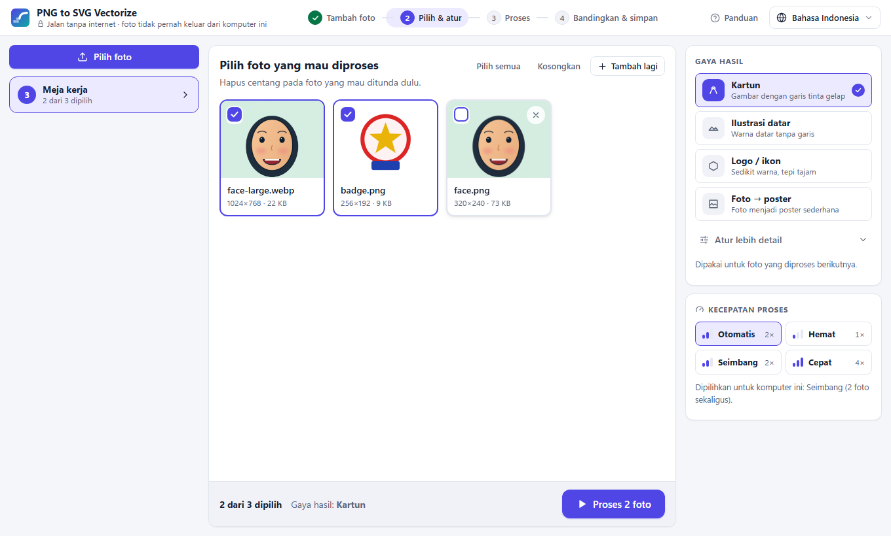

# PNG to SVG Vectorize — panduan pengguna

Ubah ilustrasi raster (PNG, WebP, JPEG) menjadi berkas SVG yang rapi dan bisa diedit: isian gradien yang halus, garis
tepi yang tajam, bentuk `<path>` murni yang bisa dipakai di browser, Figma, Illustrator, Inkscape, dan framework
aplikasi. Semua diproses di komputer Anda — tidak ada yang diunggah, tidak ada pelacakan.

*English: [user-guide.en.md](user-guide.en.md)*


## 1. Instalasi

Unduh rilis terbaru dari
[halaman GitHub Releases](https://github.com/RidhuanDEV/png-to-svg-vectorize/releases).

### Windows 10 / 11 (64-bit)

1. Unduh `PNG-to-SVG-Vectorize-Setup-x.y.z.exe` lalu jalankan. Aplikasi terpasang untuk pengguna Anda saja; tidak
   perlu hak administrator.
2. Aplikasi ini gratis dan open source sehingga **tidak ditandatangani (code signing)**. Windows SmartScreen bisa
   menampilkan *"Windows protected your PC"*. Klik **More info → Run anyway**.
3. Aplikasi membutuhkan **WebView2 Runtime** dari Microsoft Edge. Sudah ada di Windows 11 dan hampir semua Windows 10.
   Bila installer memberi tahu bahwa komponen ini tidak ada, pasang *Evergreen Runtime* dari
   <https://developer.microsoft.com/microsoft-edge/webview2/>.

Tidak mau memakai installer? Pakai `PNG-to-SVG-Vectorize-x.y.z-windows-x64-portable.zip`: ekstrak di mana saja lalu
jalankan `PNG to SVG Vectorize.exe`.

### macOS 12 atau lebih baru

1. Unduh DMG sesuai Mac Anda: `…-arm64.dmg` untuk Apple Silicon (M1 ke atas), `…-x64.dmg` untuk Mac Intel.
2. Buka DMG, lalu seret **PNG to SVG Vectorize** ke folder **Applications**.
3. Aplikasi **belum dinotarisasi** oleh Apple, jadi pembukaan pertama diblokir. Buka **System Settings → Privacy &
   Security**, gulir ke bawah, klik **Open Anyway** di samping pesan tentang PNG to SVG Vectorize, lalu konfirmasi.
   (Di macOS 14 ke bawah, klik kanan aplikasi → **Open** juga bisa.)
4. Bila macOS mengatakan aplikasi "rusak dan tidak bisa dibuka" (*is damaged*), hapus tanda karantina unduhan lewat
   Terminal:

   ```bash
   xattr -dr com.apple.quarantine "/Applications/PNG to SVG Vectorize.app"
   ```

## 2. Mengonversi gambar

Saat pertama kali membuka aplikasi, **panduan** singkat menjelaskan empat langkahnya. Lewati dengan **Lewati** (atau
Esc); buka lagi kapan saja lewat **Panduan** di bagian atas. Langkah di bagian atas jendela menunjukkan posisi Anda.

1. **Tambah foto** — seret satu atau beberapa berkas PNG, WebP, atau JPEG ke mana saja di jendela, atau tekan
   **Pilih foto**, atau tempel gambar yang disalin dengan `Ctrl+V`. Tambahkan sebanyak yang Anda mau (hingga 100 menunggu sekaligus): **belum ada yang diproses**.
   Batas: 50 MB per berkas, sisi terpanjang maksimal 8000 px; foto yang tidak bisa dipakai dijelaskan dengan pesan
   singkat.
2. **Pilih & atur** — foto menunggu di **meja kerja**. Semuanya tercentang; hapus centang pada foto yang mau ditunda
   (**Pilih semua** / **Kosongkan** membantu bila fotonya banyak). Pilih **gaya hasil** di kanan (bagian 4). Lalu tekan
   **Proses N foto**.

   
3. **Proses** — foto mengantre dan diubah satu per satu; daftar di kiri menunjukkan urutan antrean tiap foto dan
   prosesnya (membaca garis → membagi warna → menghaluskan kurva → menyusun SVG). Anda bisa lanjut bekerja, menambah
   foto, atau **Hentikan** satu foto atau **Hentikan semua** (ditanyakan dulu; hasil yang selesai tetap ada). Setelah
   semuanya selesai, muncul pesan berapa hasil yang siap.
4. **Bandingkan & simpan** — klik foto yang selesai di kiri (bagian 3 dan 5). Foto yang ditunda tetap ada di
   **Meja kerja**, satu klik saja.

**Kecepatan proses** (kolom kanan) menentukan berapa foto yang diubah bersamaan. Proses ini berat untuk prosesor,
jadi bawaannya berhati-hati:

| Kecepatan | Bersamaan | Kapan dipakai |
|---|---|---|
| Otomatis (bawaan) | dipilihkan untuk komputer ini: *Hemat* di kebanyakan laptop, *Seimbang* di komputer 6+ core dan memori 12 GB+ | biarkan saja |
| Hemat | 1 | komputer lama/lambat, atau sambil memakai program lain |
| Seimbang | 2 (komputer 4+ core) | jalan tengah |
| Cepat | hingga 4 (selalu menyisakan satu core) | banyak foto dan tidak ada program lain |

Proses selalu berjalan dengan prioritas rendah sehingga komputer tetap lancar. Ilustrasi 1536×1024 biasanya selesai
5–10 detik. Bila jendela ditutup saat masih ada foto menunggu atau diproses, aplikasi bertanya dulu.

Untuk menghapus hasil, tekan ikon tempat sampahnya; ada beberapa detik untuk menekan **Urungkan**.

## 3. Membandingkan asli dan SVG

- **Berdampingan**: gambar asli di kiri, SVG di kanan. Gulir untuk zoom (hingga 800%), seret untuk menggeser — kedua
  sisi bergerak bersama. **Pas** (atau tombol `0`) menampilkan seluruh gambar; tombol `+` / `-` dan panah juga bisa.
- **Geser**: satu tampilan dengan garis pembatas; seret pegangannya (atau ← →) untuk membandingkan.
- **Lapisan**: tampilkan *Semua*, *Isian saja*, atau *Garis saja* untuk memeriksa tiap bagian SVG.
- **Hasil** menampilkan **kemiripan** (seberapa mirip tampilan SVG dengan aslinya, 100% = identik; hasil yang baik
  sekitar 98–99%), jumlah wilayah, gradien, dan bentuk garis, ukuran berkas, serta waktu proses.

Selalu periksa detail di perbesaran 200% atau lebih: satu angka bisa menyembunyikan cacat kecil di satu bagian.

## 4. Pengaturan

**Gaya hasil** — pilih yang sesuai dengan gambar sebelum menekan Proses (atau proses ulang setelahnya):

| Gaya | Untuk |
|---|---|
| Kartun | karakter dengan garis tinta gelap dan bayangan halus (bawaan) |
| Ilustrasi datar | bentuk warna solid dengan sedikit garis; hanya gradien yang jelas dipertahankan |
| Logo / ikon | sedikit warna datar dan geometri tepat; tanpa gradien |
| Foto → poster | foto atau lukisan menjadi vektor bergaya poster dengan wilayah lebih sedikit dan besar |

**Atur lebih detail** (opsional; titik muncul bila ada yang berbeda dari gaya). Untuk menerapkan pengaturan baru ke foto yang sudah selesai, pilih fotonya lalu tekan **Proses ulang dengan gaya ini**:

| Pengaturan | Efek |
|---|---|
| Pisahkan garis tinta | garis gelap menjadi lapisan tersendiri yang tajam |
| Isian gradien / Gradien radial | bayangan halus sebagai gradien; mati = warna datar |
| Toleransi kurva | lebih besar = titik kurva lebih sedikit & berkas lebih kecil; lebih kecil = lebih dekat ke piksel |
| Penghalusan | lebih besar = batas antar-warna lebih halus |
| Gabung warna mirip (ΔE) | lebih besar = wilayah lebih sedikit (lebih sederhana); lebih kecil = lebih detail |
| Detail garis | resolusi untuk menelusuri garis (otomatis biasanya sudah tepat) |
| Hapus bintik lebih kecil dari | bintik kecil (dalam piksel) digabung ke tetangganya |
| Pengisi celah | garis tipis di sekeliling setiap bentuk yang menutup celah rambut saat diperbesar (0 = tanpa) |
| Warna | *Warna*, *Abu-abu*, atau *Hitam-putih* (dengan tingkat abu pemisah hitam dan putih) |
| Jumlah warna | *Bebas* (dengan gradien) atau 2–32 warna datar, termasuk tinta |
| Palet | setelah **Pakai warna ini** pada hasil: ubah warna (klik), tambah, atau hapus — areanya memakai warna terdekat |
| Latar transparan | latar tidak disertakan: piksel transparan, atau area yang menutupi sebagian besar tepi gambar |
| Bentuk | *Bertumpuk* (berkas terkecil) atau *Berlubang*: setiap bentuk dilubangi dan tidak ada yang menumpuk (mesin potong, penyuntingan) |

**Profil gaya** — simpan gaya dan penyesuaian saat ini dengan sebuah nama (**+**), pilih lagi dari daftar, **ekspor**
sebagai `<nama>.pngsvg-profile.json` untuk dibagikan ke tim, atau **impor**. Baris perintah membaca berkas yang sama:
`png2svg gambar/*.png --profile merek.pngsvg-profile.json`.

Foto yang diproses berikutnya selalu memakai pengaturan saat itu. **Kembalikan ke bawaan gaya** memulihkan nilai bawaan.

### Pengaturan aplikasi

Buka **Pengaturan** lewat ikon roda gigi di atas (atau `Ctrl+,`). Perubahan langsung berlaku dan diingat.

| Bagian | Yang bisa diubah |
|---|---|
| Tampilan | bahasa · tema: *Ikuti sistem* (Kertas & tinta saat komputer terang, Lightbox saat gelap), *Kertas & tinta*, *Lightbox*, *Cetak biru* · kepadatan · ukuran teks (90–130%) · kurangi animasi · tampilkan panduan lagi |
| Pemrosesan | kecepatan proses · ukuran foto terbesar yang diterima (3000–8000 px; turunkan di komputer bermemori kecil) · berapa foto yang boleh menunggu di meja kerja · model AI (unduh/hapus) dan tempat AI dijalankan |
| Hasil | gaya untuk foto baru · folder simpan dan apakah selalu ditanya (aplikasi desktop) · nama berkas dengan `{nama}`, `{gaya}`, `{tanggal}` · presisi koordinat (0–3 desimal: lebih sedikit = berkas lebih kecil) · tambahkan lebar dan tinggi ke SVG |
| Privasi & data | log diagnostik nyala/mati dan foldernya (aplikasi desktop) |
| Tentang | versi, lisensi, **Periksa pembaruan** (hanya saat ditekan; menanyakan nomor versi terbaru ke GitHub) |

### Perhalus dengan AI (opsional)

Model AI bisa membersihkan dan memperbesar foto sebelum divektorisasi sehingga tepinya lebih halus. Paling terasa pada
gambar kecil, buram, atau JPEG; prosesnya menjadi lebih lambat (sekitar 3–4×).

1. **Pengaturan → Pemrosesan → Model AI**: tekan **Unduh** di samping *Ilustrasi* (disarankan, 17 MB; untuk gambar,
   kartun, dan ilustrasi datar) atau *Umum* (5 MB; foto dan gambar campuran). Berkas diambil sekali dari rilis GitHub
   proyek ini, diperiksa keasliannya, lalu disimpan di komputer — setelah itu bekerja tanpa internet. **Hapus**
   menghapusnya.
2. Di panel gaya, **Perhalus dengan AI**: *Mati*, *Otomatis* (bawaan — hanya foto di bawah 1000 px atau JPEG), atau
   *Selalu*. Panel hasil menunjukkan apakah AI dipakai.
3. **Jalankan AI di**: *Otomatis* memakai kartu grafis bila didukung (DirectML di Windows, Core ML di Mac Apple
   Silicon) dan beralih ke prosesor bila tidak; pilih *Prosesor saja* bila kartu grafis bermasalah.

Tidak tersedia di Mac Intel. Model: Real-ESRGAN oleh Xintao Wang dkk., BSD-3-Clause.

## 5. Menyimpan

Pilih formatnya dulu:

| Format | Untuk |
|---|---|
| SVG | web, Figma, Illustrator, Inkscape, Flutter — vektor yang bisa diedit |
| PDF | cetak dan dokumen; vektor dengan gradien asli, bisa dibuka di Illustrator |
| EPS | percetakan dan aplikasi desain lama (PostScript level 3) |
| DXF | CAD, mesin laser, dan plotter: garis saja, satu lapisan per warna |
| PNG | gambar tajam yang digambar dari vektor di 1×, 2×, 4×, atau 8× ukuran foto |

- **Simpan** menyimpan hasil yang dipilih dalam format itu (aplikasi menanyakan lokasinya, atau langsung menyimpan ke
  folder simpan yang dipilih di Pengaturan).
- **Simpan semua** menyimpan semua hasil yang sudah selesai ke folder pilihan Anda (SVG, PDF, EPS, atau DXF); berkas
  yang sudah ada tidak pernah ditimpa (dipakai `nama-2.svg`).
- **Salin kode SVG** / **Salin PNG** menyalin hasil ke clipboard, siap ditempel ke kode atau aplikasi desain.

ID gradien unik per berkas, jadi banyak SVG bisa disisipkan di satu halaman web.

## 6. Tips agar hasil terbaik

- Paling cocok untuk ilustrasi yang bersih: kartun, gambar datar, ikon, logo. Foto menghasilkan banyak wilayah (pakai
  *Foto → poster*).
- Pakai versi terbesar dan paling tajam yang Anda punya (sekitar 1000–2000 px di sisi terpanjang). Hindari JPEG yang
  terkompresi berat: noise-nya menjadi wilayah-wilayah kecil.
- Bila detail kecil hilang, turunkan *Gabung warna mirip*; bila berkas terlalu besar, naikkan *Toleransi kurva*.

## 7. Privasi

Aplikasi menjalankan layanan kecil di dalam dirinya yang hanya menerima koneksi dari komputer yang sama (`127.0.0.1`)
dan hanya dengan kunci acak yang dibuat setiap sesi. Gambar dan hasil disimpan di memori dan hilang saat aplikasi
ditutup. Tidak ada telemetri. Aplikasi hanya memakai jaringan bila Anda memintanya: **Periksa pembaruan** di
Pengaturan → Tentang, dan **Unduh** model AI di Pengaturan → Pemrosesan.

## 8. Pemecahan masalah

| Masalah | Solusi |
|---|---|
| Windows: jendela kosong atau aplikasi langsung tertutup | Pasang WebView2 Runtime (lihat Instalasi). |
| Windows: antivirus mengarantina aplikasi | Aplikasi tanpa tanda tangan yang dibuat dengan PyInstaller kadang ditandai. Pulihkan dan tambahkan pengecualian, atau bangun sendiri dari kode sumber. |
| macOS: "can't be opened" / "damaged" | Lihat Instalasi, langkah 3–4. |
| "Tidak diterima — 413" | Berkas lebih dari 50 MB atau 8000 px; perkecil dulu. |
| "Tidak diterima — 415" | Bukan gambar PNG, WebP, atau JPEG (yang diperiksa isi berkas, bukan namanya). |
| Unduhan model AI gagal | Periksa koneksi internet lalu tekan Unduh lagi. Berkas yang tidak cocok dengan checksum resmi dihapus, tidak pernah dipakai. |
| Masalah lain | Aplikasi menulis log: Windows `%LOCALAPPDATA%\PNG to SVG Vectorize\app.log`, macOS `~/Library/Application Support/PNG to SVG Vectorize/app.log`. Lampirkan di [GitHub issue](https://github.com/RidhuanDEV/png-to-svg-vectorize/issues) (log tidak berisi data gambar). |

## 9. Baris perintah dan Python

Mesin yang sama tersedia tanpa aplikasi (Python 3.10+):
`pip install "png-to-svg-vectorize @ git+https://github.com/RidhuanDEV/png-to-svg-vectorize"`, lalu
`png2svg gambar.png`. Opsi studio juga tersedia, misalnya `png2svg logo.png -o logo.pdf --max-colors 4 --remove-bg`,
atau `--profile merek.pngsvg-profile.json` untuk gaya yang disimpan dari aplikasi (`png2svg --help` menampilkan
semuanya). Lihat [README](../README.md) untuk UI browser (`png2svg serve`) dan API Python.
